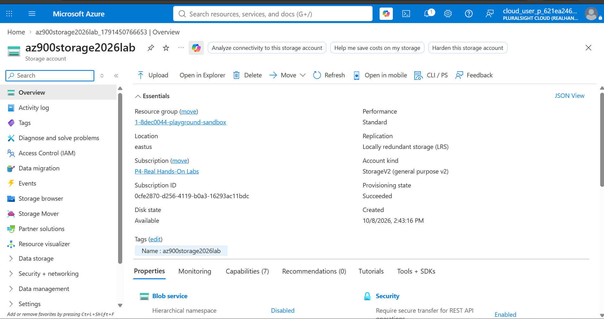
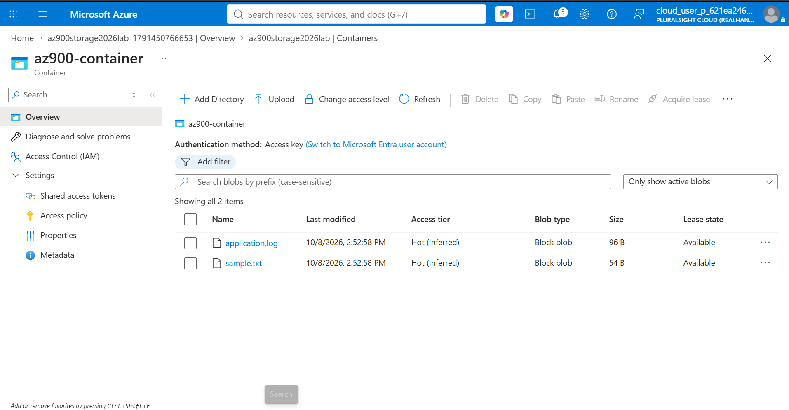

# Lab 05 — Azure Storage Account & Blob Storage

> **AZ-900 Hands-On Journey | Phase 2: Application, Storage & Security**  
> **Status:** Hands-on checklist pending verification — update after completing each exercise.  
> **LinkedIn:** This lab will be combined with Labs 6 (App Service) and 7 (Entra ID/RBAC) for Post 2.

## 1. Overview

This lab explores Azure Storage by creating a general-purpose v2 Storage Account, a private Blob container, and sample blobs. It also covers secure access with Shared Access Signatures (SAS), blob access tiers, redundancy, Azure CLI verification, troubleshooting, and resource cleanup.

**Learning objectives**

- Explain Azure Blob Storage, Azure Files, Queue Storage, and Table Storage.
- Distinguish a Storage Account, container, and blob.
- Upload and download objects in a private container.
- Understand the difference between a public network endpoint and anonymous blob access.
- Use a short-lived, read-only SAS where lab permissions allow.
- Compare Hot, Cool, Cold, and Archive access tiers.
- Compare LRS, ZRS, GRS, GZRS, and read-access variants.
- Recognize the difference between management-plane and blob data-plane RBAC.
- Inspect resources with Azure CLI and remove lab resources safely.

## 2. Architecture

```text
                       Azure subscription
                              |
                Existing sandbox resource group
                              |
                     Storage Account (GPv2)
                     Standard performance / LRS
                              |
          +-------------------+-------------------+
          |                   |                   |
     Blob service       Azure Files*       Queues/Tables*
          |
    az900-container
    (private access)
          |
      +---+------------+
      |                |
  sample.txt      application.log
      |
      +--> Authorized portal / Azure CLI access
      +--> Optional short-lived read-only SAS URL

*Explored conceptually; not necessarily deployed in this lab.
```

**Security:** The container is private. Enabling a public network endpoint does **not** grant anonymous access to blobs. HTTPS is required for data transfer.

## 3. Lab environment and naming

| Property | Lab value / guidance |
|---|---|
| Subscription | Lab-provided subscription; verify each session |
| Resource group | Existing sandbox RG; verify exact name in the portal |
| Region | East US, if available and permitted |
| Storage account | `az900storage<unique-suffix>` (globally unique, 3–24 lowercase letters/numbers) |
| Account type | StorageV2 (general-purpose v2) |
| Performance | Standard |
| Redundancy | LRS |
| Container | `az900-container` |
| Container access | Private (no anonymous access) |
| Sample objects | `sample.txt`, `application.log` |

> **Sandbox note:** Some Pluralsight lab subscriptions restrict creating resources, role assignments, SAS, or Cloud Shell. Record any restrictions honestly instead of claiming the blocked step was performed. Do not delete the shared sandbox resource group.

## 4. Prerequisites

- Azure Portal access and permission to create a Storage Account in the assigned resource group.
- Azure CLI in Cloud Shell or locally, if permitted.
- A local text editor and two small test files.
- Awareness of costs and lab time limits.

## 5. Step-by-step implementation

### Step 1 — Verify the subscription and resource group

1. Open **Azure Portal → Subscriptions** and confirm the active lab subscription.
2. Open **Resource groups** and locate the sandbox resource group.
3. Record the actual resource group name and allowed region.
4. Avoid creating or deleting unrelated resources.

Optional CLI checks:

```bash
az account show --output table
az group list --output table
```

### Step 2 — Create a Storage Account

1. Go to **Storage accounts → Create**.
2. Select the active subscription and sandbox resource group.
3. Enter a globally unique name such as `az900storage2610abc`.
4. Choose **East US** (or your lab's permitted region), **Standard** performance, and **LRS** redundancy.
5. In **Advanced**, enable **Secure transfer required** and choose **TLS 1.2 or newer**, if available.
6. Disable anonymous blob access at the account level.
7. Leave hierarchical namespace disabled for this introductory lab.
8. In **Networking**, allow public network access for this exercise only if permitted; this does not make private blobs anonymous.
9. Select **Review + create → Create → Go to resource**.

**Evidence:** `screenshots/01-storage-account-overview.png`

### Step 3 — Explore available storage services

In the Storage Account navigation, locate **Containers**, **File shares**, **Queues**, and **Tables**. You do not need to provision each service.

| Service | Typical use |
|---|---|
| Blob Storage | Images, documents, log exports, backups |
| Azure Files | Managed SMB/NFS file shares (support depends on configuration) |
| Queue Storage | Messages for asynchronous workloads |
| Table Storage | Schemaless NoSQL key-attribute data |
| Managed Disks | Block storage attached to Azure VMs; managed separately from Blob containers |

### Step 4 — Create a private Blob container

1. Select **Data storage → Containers → + Container**.
2. Name it `az900-container`.
3. Set **Anonymous access level: Private (no anonymous access)**.
4. Create the container.

**Evidence:** `screenshots/02-private-container.png`

### Step 5 — Create and upload test files

On Windows PowerShell:

```powershell
New-Item -ItemType Directory -Force C:\azure-az900-storage
Set-Location C:\azure-az900-storage
'Azure AZ-900 Storage Lab' | Set-Content sample.txt
'Application logs stored in Azure Blob Storage' | Set-Content application.log
```

In the portal, open `az900-container`, select **Upload**, and upload both files. Confirm their names and sizes appear in the list.

**Evidence:** `screenshots/03-blob-upload.png`

### Step 6 — Download and verify a blob

Select `sample.txt` → **Download**, open the downloaded file, and verify it contains:

```text
Azure AZ-900 Storage Lab
```

This demonstrates the object lifecycle: **upload → store → download**.

### Step 7 — Verify private access

1. Select `sample.txt` and copy its **Blob URL**.
2. Open the URL in an incognito browser without signing in or adding credentials.
3. Expect the unauthenticated request to be rejected; the exact HTTP/XML error can vary.

Example URL structure (placeholder, not a real endpoint):

```text
https://<storage-account>.blob.core.windows.net/az900-container/sample.txt
```

**Concept:** Public network reachability and permission to read blob data are separate controls. A blocked company network can also prevent a browser test; that alone does not prove the storage authorization behavior.

### Step 8 — Optional: Generate a short-lived SAS

If allowed by the lab:

1. Open the blob's **Generate SAS** action.
2. Select **Read** permission only.
3. Use **HTTPS only** and a short expiry (for example, 15 minutes).
4. Generate the **Blob SAS URL** and test it while valid.
5. Wait until expiry or discard the URL after the exercise.

A service SAS signed with an account key requires account-key access; this may be disabled in some subscriptions. Prefer identity-based approaches and user-delegation SAS for production workflows where supported.

**Never** publish the SAS URL, query string, storage account keys, or screenshots that expose them.

**Evidence:** `screenshots/04-sas-settings-redacted.png` (settings only; redact credentials).

### Step 9 — Explore blob access tiers

1. Open `sample.txt` → **Change tier** (if offered).
2. Review **Hot**, **Cool**, **Cold**, and **Archive**.
3. Optionally change the test blob from **Hot** to **Cool** and verify the new tier.
4. Avoid switching to Archive for this lab because archived data requires rehydration for normal reads and may incur additional costs.

| Tier | Intended usage | Important tradeoff |
|---|---|---|
| Hot | Frequently accessed objects | Higher storage cost, lower access cost |
| Cool | Infrequently accessed objects | Lower storage cost, higher access/retrieval costs |
| Cold | Rarely accessed objects | Lower storage cost, higher access/retrieval costs |
| Archive | Long-term offline objects | Must rehydrate before normal reads; latency and costs apply |

**Evidence:** `screenshots/05-access-tier.png`

### Step 10 — Explore redundancy

Open the Storage Account's **Redundancy** view and inspect the configured option. You do not need to change it.

| Option | Meaning |
|---|---|
| LRS | Three copies within one physical location in the primary region |
| ZRS | Synchronous replication across availability zones in the primary region |
| GRS | LRS in primary region plus asynchronous replication to a secondary region |
| GZRS | ZRS in primary region plus asynchronous replication to a secondary region |
| RA-GRS / RA-GZRS | Read access to the secondary endpoint when available |

**Evidence:** `screenshots/06-redundancy.png`

### Step 11 — Verify using Azure CLI

Set your **actual** names in the current shell:

```bash
RG="<your-sandbox-resource-group>"
STORAGE="<your-storage-account-name>"

az storage account show --resource-group "$RG" --name "$STORAGE" --output table
az storage account list --resource-group "$RG" --output table
```

Blob data-plane commands (require suitable Blob data permissions):

```bash
az storage container list --account-name "$STORAGE" --auth-mode login --output table
az storage blob list --account-name "$STORAGE" --container-name az900-container --auth-mode login --output table
```

If you get `AuthorizationPermissionMismatch` or an RBAC-related error, your login may lack a role such as **Storage Blob Data Reader**. Being able to manage a Storage Account does not necessarily authorize reading its blobs. Do not assign yourself roles unless the lab permits it.

**Evidence:** `screenshots/07-cli-verification.png`

## 6. Troubleshooting guide

| Symptom | Checks |
|---|---|
| Storage Account creation denied | Subscription policy, allowed regions/SKUs, RG permissions, naming uniqueness |
| Blob upload denied | Blob data-plane role, portal authentication method, account keys policy, storage firewall |
| Blob URL fails without SAS | Expected for private blobs; verify request is unauthenticated |
| SAS URL fails | Expiration, read permission, HTTPS, signature, network rules, clock skew |
| Azure CLI lists account but not blobs | Management-plane vs data-plane RBAC permissions |
| Browser cannot reach endpoint | Corporate proxy/firewall, storage networking restrictions, DNS |

## 7. What I learned (AZ-900 + DevOps)

1. **Storage architecture:** Subscription → Resource Group → Storage Account → Container → Blob.
2. **Storage types:** Blob vs Files vs Queue vs Table and their common workloads.
3. **Object operations:** Create a container, upload and download files.
4. **Security:** Private containers, secure transfer, SAS, account keys, and Microsoft Entra authorization.
5. **Networking vs authorization:** A reachable endpoint does not imply public data access.
6. **Cost optimization:** Access tiers, storage redundancy, and cleanup.
7. **Operational tooling:** Azure Portal and Azure CLI for verification.
8. **DevOps use cases:** Storing log exports, build artifacts, application assets, and backups.

## 8. Interview and certification questions

**Q1. What is a Storage Account?**  
An Azure resource that provides a namespace and configuration boundary for supported Azure Storage services.

**Q2. Blob Storage vs Azure Files?**  
Blob Storage stores objects accessed through APIs; Azure Files provides managed file shares accessible using supported file-sharing protocols.

**Q3. What is a private Blob container?**  
A container that does not permit anonymous blob reads; authorized requests are required.

**Q4. Does public network access mean public blobs?**  
No. Network access and data authorization are separate controls.

**Q5. What is SAS?**  
A signed token granting specified delegated access to storage resources, often limited by permissions and expiry.

**Q6. Hot vs Cool vs Cold vs Archive?**  
They target different access frequencies and storage/retrieval cost tradeoffs; Archive is offline until rehydrated.

**Q7. LRS vs ZRS vs GRS?**  
LRS protects copies within one physical location, ZRS across zones in one region, and GRS replicates to a secondary region.

**Q8. Why can CLI read account metadata but fail to list blobs?**  
Management-plane rights and blob data-plane rights are distinct.

**Q9. What should a production app use instead of embedding storage keys?**  
Prefer Microsoft Entra authentication with managed identities and least-privilege data roles where supported.

**Q10. What happens when a Storage Account is deleted?**  
Its contained data and services are removed subject to applicable Azure recovery/retention capabilities; treat deletion as destructive.

## 9. Screenshots

```text
lab-05-azure-storage/
├── README.md
└── screenshots/
    ├── 01-storage-account-overview.png
    ├── 02-private-container.png
    ├── 03-blob-upload.png
    ├── 04-sas-settings-redacted.png
    ├── 05-access-tier.png
    ├── 06-redundancy.png
    └── 07-cli-verification.png
```

Add images to the README after capturing them, for example:

```markdown



```

Redact account identifiers, keys, SAS query strings, and any other credentials before publishing.

## 10. Cleanup

After saving evidence, delete **only the disposable Storage Account created for this lab**, not the shared sandbox Resource Group.

**Portal:** Storage accounts → your lab account → **Delete** → confirm.

**CLI (destructive):**

```bash
az storage account delete --name "<your-storage-account-name>" --resource-group "<your-sandbox-resource-group>" --yes
```

Verify that the account is gone:

```bash
az storage account list --resource-group "<your-sandbox-resource-group>" --output table
```

> Deleting the Storage Account can remove all blobs and other data within it. Confirm the target account name before running the delete command.

## 11. Completion checklist

- [ ] Verified subscription and Resource Group
- [ ] Created a Standard LRS Storage Account
- [ ] Created a private Blob container
- [ ] Uploaded two test files
- [ ] Downloaded and verified `sample.txt`
- [ ] Tested or documented unauthenticated blob access
- [ ] Tested SAS, or documented sandbox restriction
- [ ] Explored access tiers and redundancy
- [ ] Ran Azure CLI checks, or documented RBAC restriction
- [ ] Saved screenshots with secrets redacted
- [ ] Deleted disposable lab resources

## 12. Lab outcome and next step

**Record your actual result here after practicing:**

- Storage Account created: `Yes / No`
- Container created: `Yes / No`
- Upload/download verified: `Yes / No`
- SAS tested: `Yes / No / Restricted`
- CLI verified: `Yes / No / Restricted`
- Cleanup completed: `Yes / No`

**Next:** Lab 6 — Azure App Service (PaaS), followed by Lab 7 — Microsoft Entra ID and Azure RBAC. These three labs will form **LinkedIn Post 2: Application Hosting, Storage & Security**.
