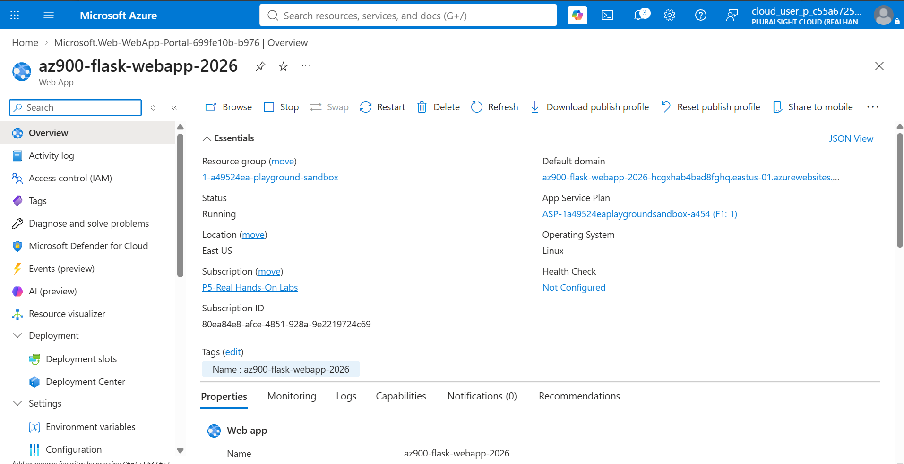
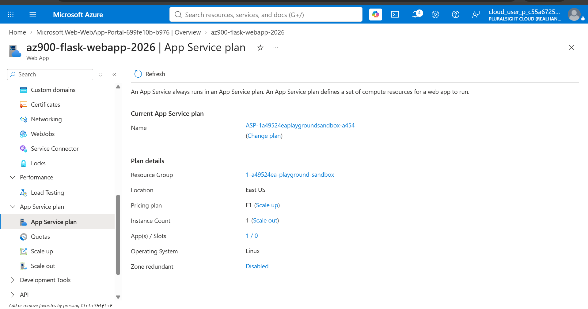
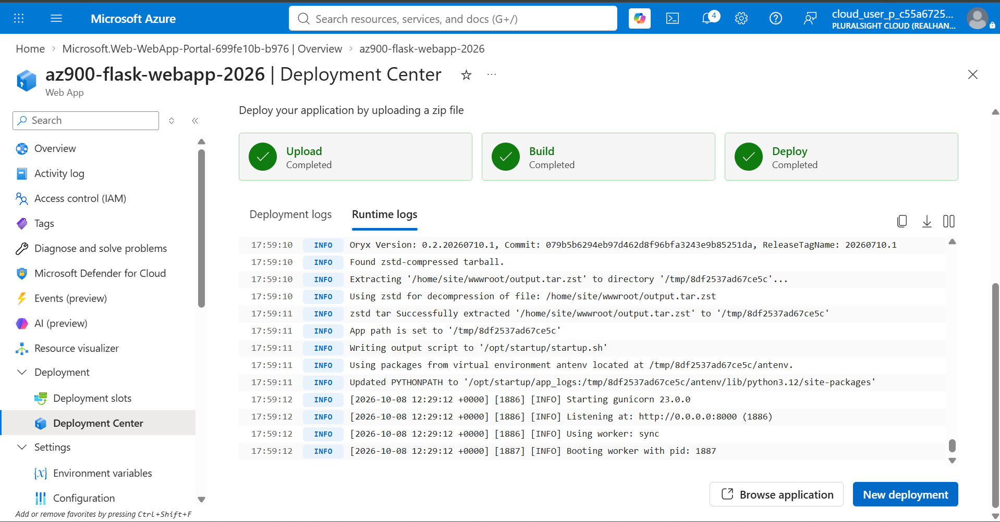
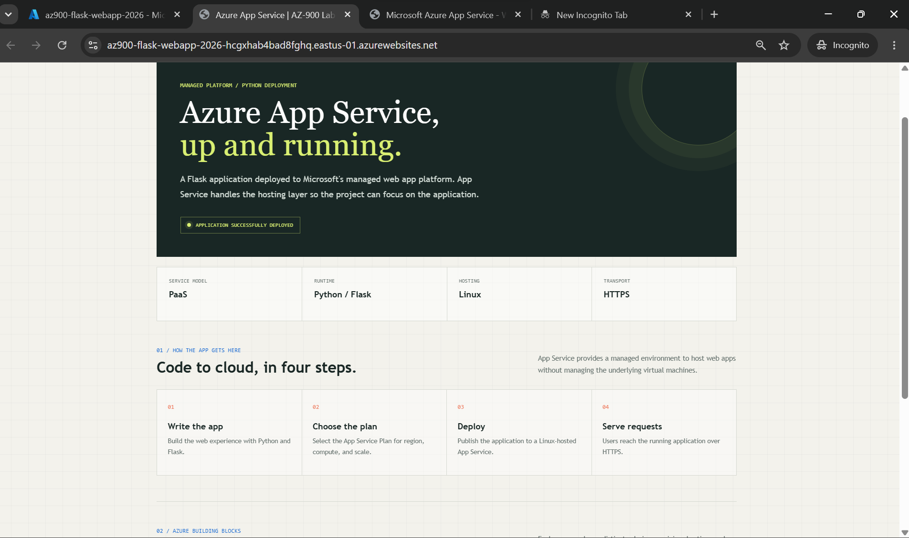

# Lab 6 — Azure App Service (PaaS)

## AZ-900 Hands-On Learning | GitHub README.md

Below is your **Lab 6 README.md**, documenting what you implemented, what you learned, important AZ-900 exam concepts, and DevOps use cases.

You can copy this directly into your GitHub repository.

---

# 🚀 Lab 06 — Azure App Service (PaaS)

## 1. Project Overview

As part of my **Microsoft Azure Fundamentals (AZ-900)** certification preparation, I completed a hands-on lab using **Azure App Service**.

In this lab, I deployed a Python Flask web application to Azure App Service using Linux hosting.

Unlike Azure Virtual Machines (IaaS), Azure App Service provides a managed platform where Microsoft handles the underlying infrastructure, allowing developers and DevOps engineers to focus on application deployment, configuration, scaling, and monitoring.

### Objectives

* Understand Platform as a Service (PaaS).
* Understand Azure App Service and App Service Plans.
* Deploy a Python Flask application.
* Configure application settings.
* Understand vertical and horizontal scaling.
* Explore application logging and monitoring.
* Verify deployment using Azure CLI.
* Understand the difference between IaaS and PaaS.

---

# 2. Architecture

```text
                     INTERNET
                         |
                         |
                    HTTPS :443
                         |
                         v
              +----------------------+
              |   Azure App Service  |
              |                      |
              |    Linux Web App     |
              +----------+-----------+
                         |
                         v
              +----------------------+
              |    Python Runtime    |
              +----------+-----------+
                         |
                         v
              +----------------------+
              |  Flask Application   |
              +----------+-----------+
                         |
                         v
              +----------------------+
              |    Custom Webpage    |
              +----------------------+

              Azure Resource Group
                       |
                       v
                App Service Plan
                       |
                       v
                    Web App
```

### Request Flow

```text
User
 |
 | HTTPS Request
 v
Azure App Service Endpoint
 |
 v
Python Flask Application
 |
 v
HTML Response
 |
 v
User Browser
```

---

# 3. Azure Resources Used

| Resource             | Purpose                                                 |
| -------------------- | ------------------------------------------------------- |
| Azure Resource Group | Organizes related Azure resources                       |
| Azure App Service    | Hosts the Flask web application                         |
| App Service Plan     | Defines hosting capacity and pricing                    |
| Linux Runtime        | Provides the managed application environment            |
| Python               | Application programming language                        |
| Flask                | Python web framework                                    |
| Gunicorn             | Python WSGI application server                          |
| HTTPS                | Secures communication between users and the application |
| Azure CLI            | Manages and verifies Azure resources                    |

### Application Details

```text
Application Name : az900-flask-webapp-2026
Application Type : Python Flask
Hosting Platform : Azure App Service
Operating System : Linux
Service Model    : PaaS
Protocol         : HTTPS
```

---

# 4. What I Learned

## 4.1 What is Azure App Service?

Azure App Service is a fully managed **Platform as a Service (PaaS)** offering from Microsoft Azure.

It allows developers to host:

* Web applications
* REST APIs
* Application backends
* Supported containerized applications

Azure App Service supports programming languages such as:

```text
Java
Python
Node.js
.NET
PHP
```

### Real-world DevOps example

Suppose a company has a Java Spring Boot application.

Instead of creating a VM, installing Java, configuring a web server, and maintaining the operating system, the application can be deployed to a supported Azure App Service runtime.

```text
Developer
    |
    v
Application Code
    |
    v
CI/CD Pipeline
    |
    v
Azure App Service
    |
    v
Running Application
```

### AZ-900 Exam Point

**Azure App Service is an example of PaaS.**

---

## 4.2 Infrastructure as a Service vs Platform as a Service

In Lab 4, I deployed an Ubuntu Linux VM and manually installed Nginx.

In Lab 6, I deployed an application directly to Azure App Service.

### Comparison

| Feature                   | Azure VM (IaaS)     | Azure App Service (PaaS)                                |
| ------------------------- | ------------------- | ------------------------------------------------------- |
| Physical infrastructure   | Microsoft manages   | Microsoft manages                                       |
| Operating system          | Customer manages    | Microsoft manages                                       |
| OS patching               | Customer manages    | Microsoft manages                                       |
| Application code          | Customer manages    | Customer manages                                        |
| Application deployment    | Customer manages    | Customer manages                                        |
| Application configuration | Customer manages    | Customer manages                                        |
| Scaling                   | Customer configures | Customer configures using managed platform capabilities |
| Example                   | Ubuntu VM + Nginx   | Flask application on App Service                        |

### Key Learning

With IaaS, the customer has more control and responsibility.

With PaaS, Microsoft manages more of the underlying platform.

### AZ-900 Exam Point

**IaaS provides greater infrastructure control, while PaaS reduces infrastructure management responsibilities.**

---

## 4.3 What is an App Service Plan?

An App Service Plan defines the compute resources available to Azure App Service applications.

It determines:

* Region
* Operating system
* Pricing tier
* Compute capacity
* Available scaling features

### Architecture

```text
Azure Resource Group
        |
        v
App Service Plan
        |
        +---- Web App 1
        |
        +---- Web App 2
        |
        +---- Web App 3
```

Multiple Web Apps can share the same App Service Plan when their hosting requirements are compatible.

### Important Concept

The App Service Plan provides the hosting capacity.

The Web App contains the application and its configuration.

### AZ-900 Exam Point

**App Service Plan = Hosting compute and pricing configuration.**

**Web App = Application hosted on Azure.**

---

## 4.4 Deploying a Python Flask Application

I created a Python Flask application and deployed it to Azure App Service.

### Project Structure

```text
azure-app-service-lab/
│
├── app.py
├── requirements.txt
├── startup.txt
└── README.md
```

### Application Components

**app.py**

Contains the Flask application and HTTP routes.

**requirements.txt**

Defines Python dependencies.

Example:

```text
Flask>=3.0,<4.0
gunicorn>=22,<24
```

**startup.txt**

Documents the application startup command.

```bash
gunicorn --bind=0.0.0.0:8000 app:app
```

### Deployment Flow

```text
Python Application
        |
        v
Create Deployment Package
        |
        v
Azure CLI Deployment
        |
        v
Azure App Service
        |
        v
Install Dependencies
        |
        v
Start Flask Application
        |
        v
Application Available via HTTPS
```

### What I Learned

Azure App Service simplifies application deployment by providing a managed hosting environment.

---

## 4.5 HTTPS and Application Access

After deploying the Flask application, I accessed it using the Azure App Service HTTPS endpoint.

Example:

```text
https://<web-app-hostname>.azurewebsites.net
```

### Request Flow

```text
Browser
   |
   | HTTPS :443
   v
Azure App Service
   |
   v
Flask Application
   |
   v
HTML Response
```

### What I Learned

HTTPS encrypts communication between the client and the Azure App Service endpoint.

Azure App Service provides a default HTTPS-enabled hostname.

### AZ-900 Exam Point

HTTPS uses TCP port **443**.

---

## 4.6 Application Settings and Environment Variables

I explored how Azure App Service manages application configuration.

### Example Configuration

| Setting      | Value    |
| ------------ | -------- |
| APP_ENV      | learning |
| PROJECT_NAME | AZ900    |

These values can be configured through:

```text
Azure Portal
     |
     v
App Service
     |
     v
Settings
     |
     v
Environment Variables
```

### Why are environment variables important?

Different environments require different configurations.

Example:

```text
Development
    |
    +-- APP_ENV=dev

Testing
    |
    +-- APP_ENV=test

Production
    |
    +-- APP_ENV=prod
```

### DevOps Connection

Environment variables are also used in:

* Docker
* Kubernetes
* Jenkins pipelines
* GitHub Actions
* Terraform deployments

### Key Learning

Application configuration can be managed independently of application source code.

Sensitive values should be handled through appropriate secret-management mechanisms rather than exposed in source code.

---

# 5. Scaling in Azure App Service

Scaling allows applications to handle changing workloads.

I explored two scaling methods.

## 5.1 Vertical Scaling — Scale Up

Vertical scaling increases the resources available to an application instance.

Example:

```text
Small Instance
      |
      v
Medium Instance
      |
      v
Large Instance
```

### Example

An application requires additional CPU and memory.

The App Service Plan can be upgraded to a suitable higher-capacity tier.

### AZ-900 Exam Point

**Scale Up = Increase instance capacity.**

---

## 5.2 Horizontal Scaling — Scale Out

Horizontal scaling increases the number of application instances.

Example:

```text
               Incoming Traffic
                       |
                       v
                 App Service
                       |
            +----------+----------+
            |          |          |
            v          v          v
         Instance   Instance   Instance
            1          2          3
```

### Example

An application receives significantly more user requests during peak hours.

Additional instances can help distribute the workload.

### AZ-900 Exam Point

**Scale Out = Increase instance count.**

### Important Note

Scaling features depend on the App Service Plan pricing tier.

Free tiers do not provide the same scaling capabilities as supported paid tiers.

---

# 6. Application Logging and Monitoring

I explored application logging to understand how deployment and runtime issues can be investigated.

### Common Application Problems

```text
Application Startup Failure
          |
          v
Missing Dependencies
          |
          v
Incorrect Startup Command
          |
          v
Application Exceptions
```

### Azure CLI Command

```bash
az webapp log tail \
  --resource-group <RESOURCE_GROUP> \
  --name az900-flask-webapp-2026
```

### What I Learned

Application logs help identify:

* Startup failures
* Runtime errors
* Dependency issues
* Application exceptions
* Deployment-related problems

### DevOps Connection

Application logging is an important part of observability and production troubleshooting.

---

# 7. Azure CLI Verification

I used Azure CLI to inspect the deployed App Service.

### Check Web App Details

```bash
az webapp show \
  --resource-group <RESOURCE_GROUP> \
  --name az900-flask-webapp-2026 \
  --output table
```

### Check Application State

```bash
az webapp show \
  --resource-group <RESOURCE_GROUP> \
  --name az900-flask-webapp-2026 \
  --query "state" \
  --output tsv
```

Expected:

```text
Running
```

### List App Service Plans

```bash
az appservice plan list --output table
```

### Key Learning

Azure resources can be managed and verified using both Azure Portal and Azure CLI.

A Web App reporting `Running` does not necessarily guarantee that the application endpoint is healthy. Application availability should also be verified using HTTP requests.

---

# 8. Azure App Service Troubleshooting

## Scenario 1 — Application Not Loading

### Possible Causes

* Application failed to start.
* Incorrect startup command.
* Missing dependencies.
* Deployment failure.
* Network restrictions.

### Troubleshooting Flow

```text
Application Not Accessible
          |
          v
Check App Service Status
          |
          v
Check Deployment Status
          |
          v
Check Application Logs
          |
          v
Verify Startup Command
          |
          v
Test HTTPS Endpoint
```

---

## Scenario 2 — HTTP 503 Service Unavailable

Possible reasons:

* Application process is unavailable.
* Application startup failed.
* Hosting platform or application is experiencing problems.

### Troubleshooting

Check application logs and deployment status.

```bash
az webapp log tail \
  --resource-group <RESOURCE_GROUP> \
  --name az900-flask-webapp-2026
```

---

## Scenario 3 — Application Shows Default Azure Page

Possible reasons:

* Application code was not deployed successfully.
* Deployment package contains incorrect files.
* Application startup configuration is incorrect.

### Verification

Check:

```text
app.py
requirements.txt
```

Confirm that the deployment package has the correct structure.

---

# 9. Additional Azure App Service Features

These are important concepts to understand for AZ-900.

| Feature              | Explanation                                                                                 |
| -------------------- | ------------------------------------------------------------------------------------------- |
| Deployment Slots     | Separate deployment environments such as staging and production                             |
| Custom Domains       | Configure a custom domain for an application                                                |
| TLS/SSL              | Secure application communication                                                            |
| Managed Identity     | Allows applications to authenticate to supported Azure services without storing credentials |
| Authentication       | Supports integration with identity providers                                                |
| Autoscaling          | Adjusts capacity based on supported scaling rules                                           |
| Application Insights | Application performance monitoring and diagnostics                                          |
| Azure Monitor        | Metrics, alerts, and monitoring                                                             |

**Note:** Some features require specific pricing tiers and were explored conceptually rather than implemented.

---

# 10. Important AZ-900 Exam Notes

| Question                                      | Answer                                    |
| --------------------------------------------- | ----------------------------------------- |
| What cloud model is Azure App Service?        | PaaS                                      |
| What is an App Service Plan?                  | Hosting compute and pricing configuration |
| Can multiple apps share an App Service Plan?  | Yes                                       |
| Does Azure manage the underlying OS?          | Yes                                       |
| Can App Service host Python applications?     | Yes                                       |
| Can App Service host Java applications?       | Yes                                       |
| What is vertical scaling?                     | Increasing instance capacity              |
| What is horizontal scaling?                   | Increasing instance count                 |
| What protocol secures browser access?         | HTTPS                                     |
| What port does HTTPS use?                     | TCP 443                                   |
| What are deployment slots?                    | Separate deployment environments          |
| Can App Service integrate with Azure Monitor? | Yes                                       |

---

# 11. Screenshots

The screenshots below document the actual resources and deployment state from this lab. They are stored in `azure-app-service-lab/scrrenshots/`.

### App Service resource overview

The web app is running on Linux in East US and is associated with an App Service Plan.



### App Service Plan

The plan details show the Linux operating system, F1 pricing tier, and one instance used for this learning lab.



### Deployment Center

The Deployment Center shows upload, build, and deploy completed, with the Gunicorn application process starting in the runtime logs.



### Deployed Flask application

The browser view confirms the deployed Flask page is reachable through the App Service HTTPS endpoint.



---

# 12. Real-World DevOps Use Case

Imagine a company has a Java Spring Boot REST API.

Instead of managing virtual machines, the application can be deployed to Azure App Service.

### Architecture

```text
                  Developers
                      |
                      v
                 Git Repository
                      |
                      v
                  CI/CD Pipeline
                      |
                      v
                Azure App Service
                      |
                      v
                Spring Boot API
                      |
                      v
                   End Users
```

### Benefits

* Reduced infrastructure management
* Simplified application deployment
* Managed operating system updates
* Built-in HTTPS support
* Scaling capabilities
* Integration with monitoring tools
* Integration with CI/CD workflows

This is an example architecture for understanding how Azure App Service can be used in DevOps workflows; it is not an additional deployment performed in this lab.

---

# 13. What I Learned — Summary

| Category                | Topics                                     |
| ----------------------- | ------------------------------------------ |
| Cloud Computing         | PaaS, IaaS vs PaaS                         |
| Azure Compute           | Azure App Service                          |
| Hosting                 | App Service Plan, Linux runtime            |
| Application Development | Python Flask                               |
| Deployment              | Application packaging and deployment       |
| Networking              | HTTPS, public application endpoints        |
| Configuration           | Environment variables                      |
| Scaling                 | Vertical and horizontal scaling            |
| Monitoring              | Application logs                           |
| Troubleshooting         | Startup, deployment and application errors |
| Azure Management        | Azure Portal and Azure CLI                 |
| Cost Management         | Pricing tiers and resource cleanup         |

---

# 14. Lab Completion Status

| Task                           | Status      |
| ------------------------------ | ----------- |
| Create App Service Plan        | ✅ Completed |
| Create Linux Web App           | ✅ Completed |
| Deploy Flask Application       | ✅ Completed |
| Verify HTTPS Access            | ✅ Completed |
| Configure Application Settings | ✅ Completed |
| Explore Scaling                | ✅ Completed |
| Explore Application Logs       | ✅ Completed |
| Verify Using Azure CLI         | ✅ Completed |
| Understand IaaS vs PaaS        | ✅ Completed |

**Lab 6 Status: Completed ✅**

---

# 15. Key Takeaways

Through this lab, I learned how to deploy and manage a web application using Azure App Service.

I gained practical experience with:

* Creating an Azure App Service Plan.
* Deploying a Python Flask application.
* Hosting applications on a managed Linux platform.
* Accessing applications securely using HTTPS.
* Managing application settings.
* Understanding scaling.
* Exploring application logs.
* Verifying Azure resources using CLI.

The most important takeaway was understanding the difference between **IaaS and PaaS**.

In Lab 4, I manually provisioned and configured a Linux VM with Nginx.

In Lab 6, Azure App Service handled the underlying hosting platform, allowing me to focus on deploying and managing the application.

This helped me understand how PaaS simplifies application hosting in Microsoft Azure.

---

## GitHub Directory Structure

The lab files are organized as follows:

```text
02-application-storage-security/
│
└── Lab 6 — Azure App Service (PaaS)/
    │
    ├── azure-app-service.md
    │
    └── azure-app-service-lab/
        │
        ├── app/
        │   ├── app.py
        │   ├── requirements.txt
        │   └── startup.txt
        │
        └── scrrenshots/
            ├── 01-app-service-overview.png
            ├── 02-flask-application-browser.png
            ├── 03-az900-flask-webapp-2026-Deployment-Center.png
            └── 04-az900-flask-webapp-2026-App-Service-plan.png
```

---


