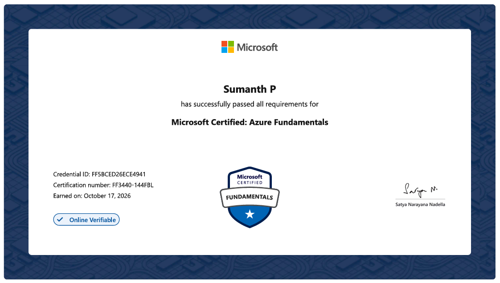
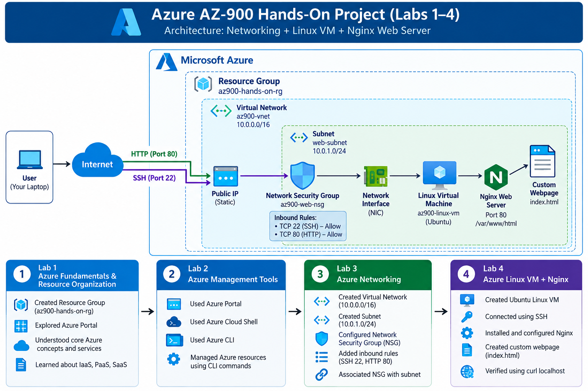
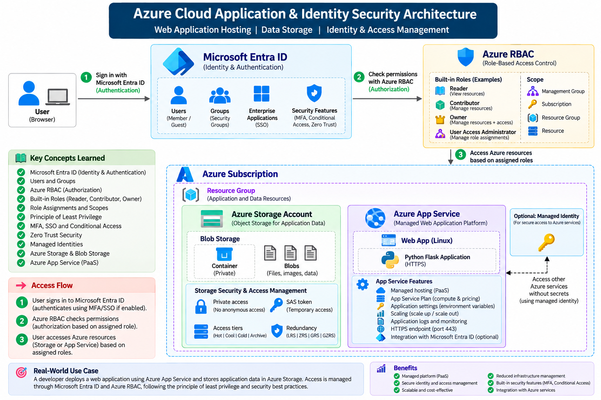

# Azure AZ-900 Hands-On Project

A practical learning repository for Microsoft Azure Fundamentals (AZ-900). It brings together guided labs, architecture diagrams, exam notes, screenshots, and small web application examples covering Azure infrastructure, application hosting, storage, identity, governance, and monitoring.


The project is organized as a learning portfolio: read the lab notes, follow the exercises in your own Azure subscription or sandbox, and record your own results. The presence of a guide or diagram in this repository does not by itself mean that the corresponding Azure resource is currently deployed.

## Author

**Sumanth Parashuram**  
Senior DevOps Engineer

### Microsoft Certified: Azure Fundamentals



## Project At A Glance

- **Certification focus:** Microsoft Azure Fundamentals (AZ-900)
- **Learning style:** Azure Portal and Azure CLI hands-on exercises, with supporting explanations and architecture diagrams
- **Main themes:** Cloud concepts, Azure architecture and services, and management and governance
- **Application examples:** A static HTML project page, an Azure Linux VM running Nginx, and a Python Flask application intended for Azure App Service
- **Cloud resources:** Create resources only in a subscription where you have permission; check pricing and clean up resources after each exercise

## Table Of Contents

- [Architecture Diagrams](#architecture-diagrams)
- [Learning Path And Labs](#learning-path-and-labs)
- [Key Concepts](#key-concepts)
- [Technology Used](#technology-used)
- [Repository Layout](#repository-layout)
- [Using The Project](#using-the-project)
- [Security And Cost Considerations](#security-and-cost-considerations)
- [Project Status](#project-status)

## Architecture Diagrams

The repository contains three architecture diagrams, one for each major learning phase.

### 1. Infrastructure And Networking



This phase introduces Azure geography and resource organization, management tools, virtual networks, subnets, network security groups, and an Ubuntu Linux virtual machine exposed through a public IP for SSH and HTTP testing.

### 2. Application Hosting, Storage, And Identity Security



This phase connects managed application hosting with Azure Storage and Microsoft Entra ID / Azure RBAC concepts. The accompanying material covers a Flask application on Azure App Service, private Blob Storage, delegated access, and least-privilege authorization.

### 3. Governance, Health, And Optimization


This diagram represents the governance and operations phase of the learning path, including Azure health and optimization themes. The directory name `Architecrure` is retained as it currently exists in the repository.

## Learning Path And Labs

### Phase 1: Infrastructure And Networking

| Lab | Topics | Notes |
|---|---|---|
| [Lab 1: Azure Geography](01-infrastructure-networking/01-Lab/01-Azure%20Geography.md) | Geographies, regions, availability zones, and datacenters | Foundational Azure global infrastructure concepts |
| [Lab 1: Azure Resource Hierarchy](01-infrastructure-networking/01-Lab/02-Azure%20Resource%20Hierarchy.md) | Tenants, management groups, subscriptions, resource groups, and resources | Understand scope, organization, and governance inheritance |
| [Lab 1: Azure Portal](01-infrastructure-networking/01-Lab/03-Azure%20Portal.md) | Navigating and exploring Azure Portal | GUI-based resource management |
| [Lab 2: Azure Management Tools](01-infrastructure-networking/02-lab/Azure%20Management%20Tools.md) | Azure Portal, Azure CLI, Azure PowerShell, and Cloud Shell | Compare ways to manage Azure |
| [Lab 3: Azure Networking](01-infrastructure-networking/03-Lab/Azure%20Networking.md) | VNets, CIDR, subnets, public/private IPs, and NSGs | Includes the `az900-vnet` and `web-subnet` learning example |
| [Lab 4: Linux VM, SSH, And Nginx](01-infrastructure-networking/04-Lab/Azure%20Linux%20VM%20%2B%20SSH%20%2B%20Nginx.md) | Ubuntu VM, network interface, public IP, SSH, and HTTP | Hosts a custom page using Nginx; restrict SSH to trusted sources |

### Phase 2: Application, Storage, And Identity Security

| Lab | Topics | Notes |
|---|---|---|
| [Lab 5: Azure Storage](02-application-storage-security/Lab%205%20%E2%80%94%20Azure%20Storage/Lab-05-Azure-Storage-README.md) | Storage accounts, Blob containers, upload/download, SAS, access tiers, redundancy, and CLI | The guide marks hands-on checklist items for verification |
| [Lab 5: AZ-900 Exam Notes](02-application-storage-security/Lab%205%20%E2%80%94%20Azure%20Storage/Lab-05-AZ900-Exam-Notes-README.md) | Storage concepts, security, redundancy, tiers, and exam review | Companion revision notes |
| [Lab 6: Azure App Service](02-application-storage-security/Lab%206%20%E2%80%94%20Azure%20App%20Service%20%28PaaS%29/azure-app-service.md) | PaaS, App Service Plans, Python/Flask deployment, scaling, and monitoring | Includes a sample application in `azure-app-service-lab/` |
| [Lab 7: Microsoft Entra ID And Azure RBAC](02-application-storage-security/Application%20Hosting%2C%20Storage%20%26%20Identity%20Security.md) | Tenants, users, groups, authentication, authorization, RBAC scopes, MFA, SSO, and managed identities | Sandbox permissions may limit write operations; follow the guide's read-only-first approach |

### Phase 3: Governance, Monitoring, And Optimization

The repository currently includes the [Phase 3 architecture diagram](03-governance-monitoring/Architecrure/Azure%20Health%20%26%20Optimization%20Architecture.png) and a screenshots folder. A detailed Lab 8 walkthrough is not currently present, so treat the diagram as an architectural learning reference rather than evidence of a deployed configuration.

## Key Concepts

### Azure organization and deployment

```text
Microsoft Entra tenant
  └── Management groups
        └── Subscriptions
              └── Resource groups
                    └── Azure resources
```

The hierarchy helps organize identities, billing and access boundaries, and related resources. Resource groups commonly group resources that share a lifecycle.

### IaaS and PaaS

| Model | Example in this project | Responsibility emphasis |
|---|---|---|
| IaaS | Ubuntu Linux VM with Nginx | You manage the guest OS and installed software as well as the application |
| PaaS | Python Flask app on Azure App Service | Azure manages more of the hosting platform; you focus on application code and configuration |

### Network and application request paths

The VM exercise demonstrates a public request path through a public IP and NSG to a VM hosting Nginx. The App Service example demonstrates a managed HTTPS endpoint serving the Flask application. These are separate learning examples, not a single combined production deployment.

### Storage and access control

The storage notes distinguish the management plane from the data plane: permission to manage a Storage Account does not automatically grant permission to read its blobs. Network reachability is also separate from authorization; a publicly reachable endpoint does not make a private container anonymously readable.

## Technology Used

- **Microsoft Azure:** Azure Portal, Azure CLI, Cloud Shell, Virtual Machines, Virtual Network, subnet, Network Security Group, Public IP, Storage Account, Blob Storage, App Service, Microsoft Entra ID, and Azure RBAC
- **Linux and web hosting:** Ubuntu Server, SSH, Nginx, Python, Flask, and Gunicorn (documented for the App Service deployment)
- **Project files:** Markdown lab guides, PNG architecture diagrams, screenshots, HTML, and a small Python application

## Repository Layout

```text
.
├── index.html
├── README.md
├── 01-infrastructure-networking/
│   ├── 01-Lab/                  # Azure geography, hierarchy, and portal
│   ├── 02-lab/                  # Azure management tools
│   ├── 03-Lab/                  # Azure networking and screenshots
│   ├── 04-Lab/                  # Linux VM, SSH, Nginx, and screenshots
│   └── Architecture/            # Phase 1 architecture diagram
├── 02-application-storage-security/
│   ├── Architecture/            # Phase 2 architecture diagram
│   ├── Lab 5 — Azure Storage/   # Storage lab, exam notes, and sample files
│   ├── Lab 6 — Azure App Service (PaaS)/
│   │   └── azure-app-service-lab/ # Flask app, dependencies, and screenshots
│   └── Lab 7 — Microsoft Entra ID & Azure RBAC/
└── 03-governance-monitoring/
    ├── Architecrure/             # Phase 3 architecture diagram
    └── LAB 8 — Azure Governance/ # Screenshots
```

## Using The Project

1. Start with the Phase 1 guides to learn Azure organization, regions, management tools, and networking.
2. Continue to the VM lab and review how the VNet, subnet, NSG, public IP, SSH, and Nginx fit together.
3. Read the Storage, App Service, and Entra ID/RBAC material in Phase 2. Verify each task in your own Azure environment before marking it complete.
4. Use the three diagrams as visual summaries and follow the linked lab documents for implementation details.
5. Review Phase 3's architecture diagram as a starting point for governance, health, and optimization topics.

### Run The Flask Sample Locally

The Flask sample is located in `02-application-storage-security/Lab 6 — Azure App Service (PaaS)/azure-app-service-lab/app/`. From that directory, create and activate a Python virtual environment, install the listed dependencies, and start the app:

```bash
python -m venv .venv
```

On Windows PowerShell:

```powershell
.\.venv\Scripts\Activate.ps1
python -m pip install -r requirements.txt
python app.py
```

On macOS or Linux:

```bash
source .venv/bin/activate
python -m pip install -r requirements.txt
python app.py
```

Open the local address printed by Flask in your browser. The root `index.html` is a separate static project page and can be opened directly.

## Security And Cost Considerations

- Use a lab or sandbox subscription and confirm its allowed regions, SKUs, and permissions before creating resources.
- Azure resources can incur charges even when they are used for learning. Review pricing, budgets, and the resource list, then remove only resources you created when finished.
- Never delete a shared sandbox resource group or resources you do not own.
- Restrict SSH (TCP 22) to trusted source IP addresses instead of exposing it broadly to the internet. Open only the ports required for the exercise.
- Keep Storage containers private unless public access is explicitly required. Prefer Microsoft Entra authorization where supported.
- Treat account keys, passwords, private keys, and SAS URLs as secrets. Do not commit them or include them in screenshots.
- Use HTTPS, short-lived and least-privilege access grants, and review role assignments at the narrowest practical scope.
- Redact tenant IDs, subscription IDs, public IPs, usernames, and other identifying information from public screenshots where appropriate.

## Project Status

This is a learning repository, not an Infrastructure-as-Code deployment package. Lab documents explain concepts and steps; some explicitly note that actions are pending verification or depend on sandbox permissions. Record what you actually completed, and do not publish credentials or claim a live deployment unless you have independently verified it.

